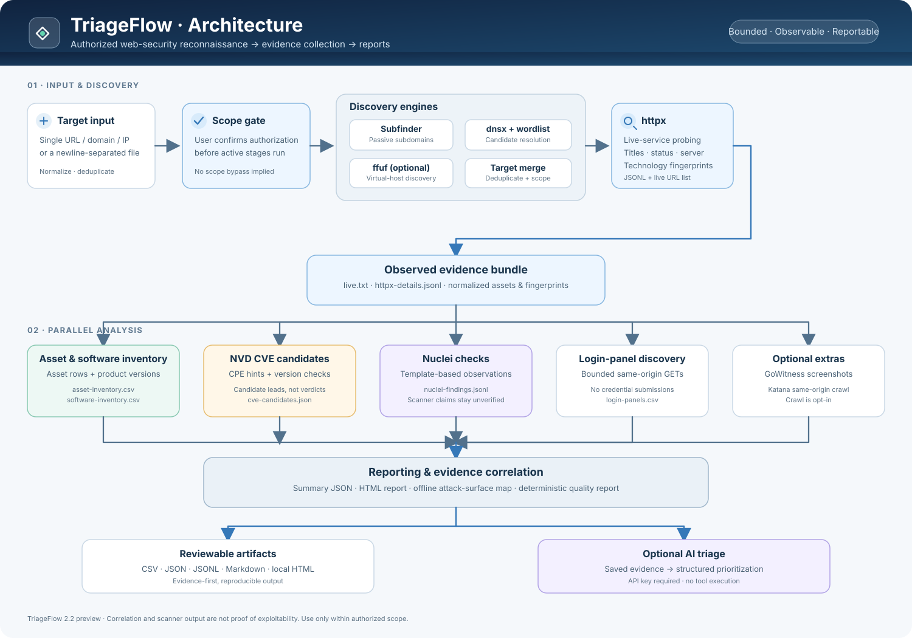
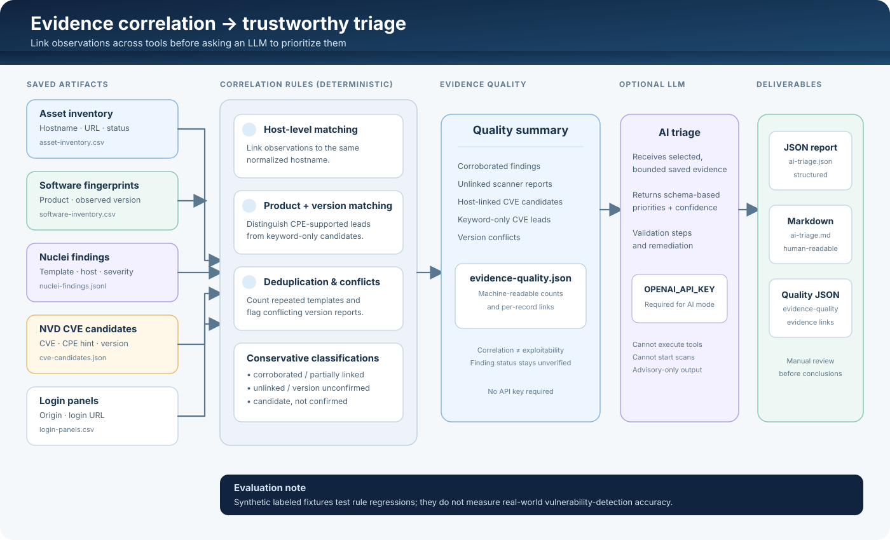

# TriageFlow 2.3.0 · Security Reconnaissance & Evidence Triage

TriageFlow 2.3.0 adds a bounded Tomcat CGI review: when a Tomcat/Apache-Coyote fingerprint is observed, it sends a small set of same-origin GET-only requests to common CGI directories and `.bat`/`.cmd` paths. It sends no query strings, command arguments, credentials, or exploit payloads. Non-404 responses are only candidates for manual review and may be caused by custom 404/catch-all routes. Disable it with `--no-tomcat-cgi-check`.

<p align="center">
  <strong>A practical, evidence-first workflow for authorized web-security assessments.</strong><br>
  Discover assets, collect observations, correlate evidence, and produce reports you can review.
</p>

<p align="center">
  <a href="https://github.com/CodebindPyth/TriageFlow/actions/workflows/tests.yml"></a>
  
  
  
</p>

> **Preview note:** Version 2.2.0 and its AI/evidence-quality features are currently on [PR #1](https://github.com/CodebindPyth/TriageFlow/pull/1), not yet merged into `main`. To try those features, use the preview-branch install command below.

**New to TriageFlow?** Follow the [Greek Quick Start Guide](QUICKSTART_EL.md).  
**Want the AI details?** See [AI_TRIAGE.md](AI_TRIAGE.md).  
**Want the change history?** Read [CHANGELOG.md](CHANGELOG.md).

---

## Contents

- [At a glance](#at-a-glance)
- [Architecture map](#architecture-map)
- [Evidence-correlation map](#evidence-correlation-map)
- [Quick start](#quick-start)
- [Reports and output files](#reports-and-output-files)
- [Evidence quality](#evidence-quality--no-api-key-required)
- [Optional AI triage](#optional-ai-triage)
- [Labeled regression checks](#labeled-regression-checks)
- [Tool roles and network behavior](#tool-roles-and-network-behavior)
- [Useful options](#useful-options)
- [Safety, privacy and limitations](#safety-privacy-and-limitations)
- [Contributing](#contributing)
- [License](#license)

## At a glance

TriageFlow is a Python CLI orchestrator for authorized web-security reconnaissance. It connects established tools, gathers their results into consistent artifacts, and adds deterministic evidence correlation plus optional LLM-assisted triage.

- **Discover:** Subfinder, dnsx/wordlists, optional ffuf virtual-host discovery.
- **Observe:** ProjectDiscovery httpx identifies live web services and visible technology fingerprints.
- **Enrich:** asset/software inventories, NIST NVD CVE candidates and bounded login-panel discovery.
- **Assess:** Nuclei template results and optional GoWitness screenshots / Katana endpoint crawling.
- **Understand:** an offline interactive attack-surface map and a single-page HTML report.
- **Correlate:** connect observations by host and product/version; flag orphaned evidence, duplicate findings and version conflicts.
- **Prioritize (optional):** use the OpenAI Responses API to turn saved evidence into a structured review plan.

TriageFlow does **not** attempt logins, submit credentials, or treat a product/CVE match as proof of exploitability. It is a workflow and triage aid, not a replacement for manual validation.

## Architecture map

The diagram below shows how targets move through discovery, HTTP observation, parallel analysis and reporting.



## Evidence-correlation map

The quality layer links artifacts before the optional model is asked to prioritize them. Its classifications describe the strength of the *evidence link*, not whether a system is exploitable.



## Quick start

### 1. Get the v2.2 preview branch

```bash
git clone --branch feat/ai-triage-openai --single-branch https://github.com/CodebindPyth/TriageFlow.git
cd TriageFlow
python3 triageflow.py
```

The guided wizard helps you choose a target, wordlist and scan profile. To inspect options without starting a scan:

```bash
python3 triageflow.py --help
```

Requirements: Python 3.10 or newer. TriageFlow uses the Python standard library for its core logic; external scanners such as Subfinder, dnsx, httpx, Nuclei and GoWitness are separate tools. The CLI checks for required tools and may install missing Go-based tools when Go is available.

### 2. Run a command-line assessment

Only replace the example with a domain, URL or IP that you own or have explicit written permission to assess.

```bash
# One authorized target
python3 triageflow.py -u https://your-authorized-target.example

# Targets from a text file (one target per line)
python3 triageflow.py -l targets.txt

# Use your own wordlist and opt in to bounded endpoint crawling
python3 triageflow.py -u https://your-authorized-target.example \
  -w /path/to/subdomains.txt \
  --crawl-endpoints
```

TriageFlow asks for an explicit `YES` confirmation before starting its active assessment workflow. This prompt is a reminder, not a substitute for authorization.

## Reports and output files

Every run gets its own timestamped results directory under `triageflow-results/`. Common artifacts include:

| Artifact | What it contains |
|---|---|
| `report.html` | Local overview of assets, fingerprints, findings, CVE candidates and stage status. |
| `attack-surface-map.html` | Searchable, zoomable, offline relationship map generated from saved data. |
| `attack-surface-map.json` | Machine-readable graph behind the map. |
| `summary.json` / `README.md` | Run status, counts, stages and a text summary. |
| `live.txt` / `httpx-details.jsonl` | Live URLs and structured httpx observations. |
| `asset-inventory.csv` | Filterable asset inventory. |
| `software-inventory.csv` | Observed products, versions and fingerprint sources. |
| `cve-candidates.json` / `cve-candidates.md` | NVD search results with automated CPE/version applicability hints. |
| `nuclei-findings.jsonl` | Template-based scanner observations. |
| `login-panels.csv` | Login-panel URLs discovered through bounded GET requests only. |
| `evidence-quality.json` | Cross-tool correlations, classification labels and mismatch/conflict counts. |
| `ai-triage.json` / `ai-triage.md` | Optional AI-assisted priorities, rationale, safe validation suggestions and remediation. |

Keep `report.html` alongside its sibling `gowitness/` folder if you want the local screenshot gallery to resolve correctly.

## Evidence quality — no API key required

You can correlate an existing run without launching a scan or calling an external AI service:

```bash
python3 triageflow.py --quality-only ./triageflow-results/YOUR_RUN_DIRECTORY
```

This writes `evidence-quality.json` in that existing results directory. The deterministic layer:

- Links scanner observations to known assets and same-host fingerprints.
- Separates CPE-supported CVE candidates from product-only and keyword-only leads.
- Counts repeated host/template observations without silently deleting the raw findings.
- Flags multiple observed versions for the same product/host instead of guessing which one is correct.
- Adds context from login panels without claiming that a login page is a vulnerability.

**Interpretation matters:** a correlated finding is still a reported observation. A CVE candidate is not confirmed until its affected-version conditions and the target's actual state are validated.

## Optional AI triage

AI triage reviews selected, bounded artifacts already saved by TriageFlow. It does not run scanners, execute tools, or contact targets. It generates `ai-triage.json` and `ai-triage.md`, and also saves the deterministic `evidence-quality.json`.

```bash
export OPENAI_API_KEY="YOUR_OPENAI_API_KEY"
export TRIAGEFLOW_AI_MODEL="gpt-6-astra"

python3 triageflow.py --ai-triage ./triageflow-results/YOUR_RUN_DIRECTORY
```

Choose a different model ID if your OpenAI API project does not have access to the default:

```bash
python3 triageflow.py \
  --ai-triage ./triageflow-results/YOUR_RUN_DIRECTORY \
  --ai-model YOUR_AVAILABLE_MODEL_ID
```

Read [AI_TRIAGE.md](AI_TRIAGE.md) for full setup instructions and limitations. A ChatGPT subscription does not automatically include API credits. Never commit an API key or send confidential/third-party evidence to an external service unless your authorization and data-handling policy permit it.

## Labeled regression checks

Run the deterministic evidence-correlation fixture:

```bash
python3 triageflow_quality.py --evaluate tests/fixtures/triage_quality_cases.json
```

The current fixture contains five synthetic scenarios and ten expected classifications. Its 100% score means the implementation matches those authored regression labels; it is **not** a measure of real-world vulnerability-detection accuracy or LLM quality.

Run the project's full test suite:

```bash
python3 -m py_compile triageflow.py triageflow_enrichment.py triageflow_reports.py triageflow_map.py triageflow_ai.py triageflow_quality.py
python3 -m unittest discover -s tests -v
```

GitHub Actions also exercises Python 3.10, 3.11, 3.12 and 3.13.

## Tool roles and network behavior

| Component | Role | Notes |
|---|---|---|
| Subfinder | Passive subdomain discovery | Optional to disable with `--no-subdomains`. |
| Recursive Subfinder | Repeats passive discovery from discovered in-scope subdomains | Opt-in with `--recursive-subdomains`; bounded by `--recursive-depth` and `--recursive-max-hosts`. Results are filtered to the supplied root domains. |
| ffuf directory discovery | Finds candidate paths on each live HTTP(S) origin | Explicit opt-in with `--dir-fuzz --dir-wordlist FILE`; request rate, threads and per-origin time are bounded. |
| dnsx + wordlist | Candidate subdomain resolution | Uses bounded timeout/retry settings and wildcard filtering. |
| httpx | Live HTTP probing and technology detection | Main source of live URLs and web-service observations. |
| NVD API | Candidate CVE enrichment | Keyword results and CPE hints require manual/vendor validation. |
| Login discovery | Finds likely authentication pages | Bounded GET-only requests; no credentials are submitted. |
| Nuclei | Template-based security checks | Finding output remains unverified until reviewed. |
| GoWitness | Screenshots | Can be skipped with `--no-screenshots`. |
| Katana | Endpoint crawling | Opt-in via `--crawl-endpoints`; bounded by depth, rate and duration. |
| Attack-surface map | Visualizes saved relationships | Offline generation; it does not contact the target. |
| AI triage | Prioritizes saved evidence | Optional external API call; no model-controlled tool execution. |

Some stages send requests to the selected targets. Use them only within your authorized scope. The attack-surface map and evidence-correlation stage operate on local artifacts.

## Useful options

| Option | Purpose |
|---|---|
| `-u URL` | Supply a single target. |
| `-l FILE` | Read targets from a text file. |
| `-w FILE` | Specify a custom wordlist. |
| `--no-subdomains` | Skip Subfinder discovery. |
| `--recursive-subdomains` | Run bounded recursive Subfinder passes on discovered subdomains. |
| `--recursive-depth N` | Maximum recursive depth (1–5, default 2). |
| `--recursive-max-hosts N` | Maximum unique recursive subdomains (default 5000). |
| `--recursive-timeout N` | Timeout per recursive Subfinder pass in seconds (10–900, default 120). |
| `--dir-fuzz --dir-wordlist FILE` | Run ffuf directory discovery against each unique live HTTP(S) origin from `live.txt`. |
| `--dir-rate N` | ffuf request rate, 1–100 requests/second (default 10). |
| `--dir-threads N` | ffuf threads, 1–50 (default 10). |
| `--dir-max-time N` | Maximum time per origin in seconds, 5–600 (default 60). |
| `--dir-timeout N` | Per-request timeout in seconds, 1–30 (default 10). |
| `--no-wordlist` | Disable automatic wordlist selection. |
| `--vhost-fuzz` | Also try virtual-host discovery with ffuf. |
| `--crawl-endpoints` | Enable bounded Katana crawling. |
| `--no-nuclei` | Skip Nuclei. |
| `--no-screenshots` | Skip GoWitness. |
| `--no-login-check` | Skip login-panel discovery. |
| `--no-cve-lookup` | Skip NVD candidate lookup. |
| `--quality-only RESULTS_DIR` | Correlate saved evidence without the AI API. |
| `--ai-triage RESULTS_DIR` | Run optional AI triage on a saved run. |
| `--help` | Show all CLI options. |

For direct virtual-host discovery without DNS pre-resolution, see `vhost_direct.py` and the detailed instructions in the [Greek guide](QUICKSTART_EL.md).

Example: `python3 triageflow.py -u example.com --recursive-subdomains --dir-fuzz --dir-wordlist /path/to/directory-wordlist.txt`. Directory discovery is opt-in and runs only on live URLs discovered for the authorized target scope. Results are saved in `ffuf-directory-findings.csv`, `ffuf-directory-findings.json`, and per-origin JSON/log files.

## Safety, privacy and limitations

- Only run active checks against systems you own or are explicitly authorized to assess.
- TriageFlow does not attempt to authenticate or submit credentials.
- NVD keyword hits, CPE hints, fingerprints and Nuclei results can be incomplete or wrong; validate before drawing conclusions.
- AI triage sends selected evidence to OpenAI only when you explicitly use `--ai-triage`. The artifacts may contain target hostnames, URLs, response titles or scanner metadata.
- AI output is advisory. Review the original evidence and vendor advisories before changing systems or reporting a vulnerability.
- Correlation can strengthen the context around an observation, but it cannot independently prove reachability, affected configuration or exploitability.

## Contributing

Issues and pull requests are welcome. See [CONTRIBUTING.md](CONTRIBUTING.md) before proposing larger changes. Keep test fixtures synthetic or properly authorized, never commit credentials, and add regression tests for bug fixes.

## License

TriageFlow is released under the [MIT License](LICENSE).
